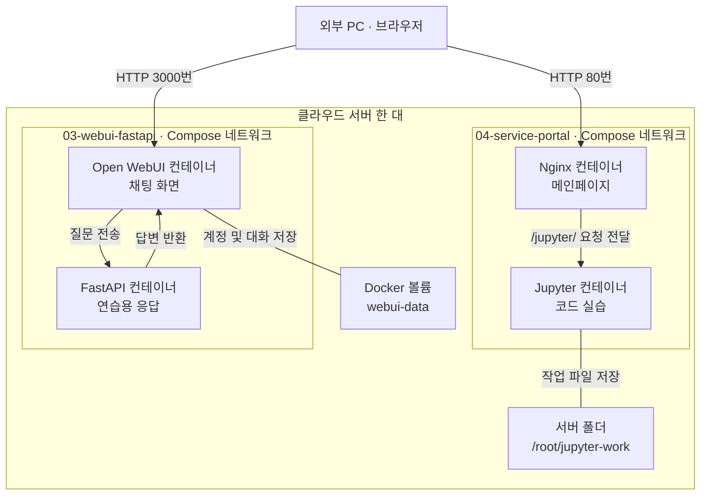

# 04. 서비스 메인페이지 구축

## 실습 목표

클라우드 서버 한 대에서 Docker 컨테이너로 여러 서비스를 실행하고,
메인페이지의 카드를 눌러 Jupyter Lab과 AI 채팅 화면에 접속한다.

## 구성 환경

- Rocky Linux 8.10
- Docker 및 Docker Compose
- Nginx: 메인페이지 제공 및 Jupyter 요청 전달
- Jupyter Lab: Python 코드 실습
- Open WebUI: 채팅 화면
- FastAPI: 연습용 채팅 응답

GPU와 실제 LLM은 사용하지 않는다.
FastAPI가 질문에 정해진 문구를 붙여 응답하는 연결 실습이다.

## 전체 아키텍처



## 서비스 접속 방식

| 선택한 메뉴 | 요청 경로 |
|---|---|
| 메인페이지 | 브라우저 → 서버 80번 → Nginx |
| Jupyter Lab | 브라우저 → Nginx → Jupyter 8888번 |
| AI 채팅 | 브라우저 → 서버 3000번 → Open WebUI → FastAPI |

Jupyter 카드는 같은 주소의 `/jupyter/`로 이동한다.
Nginx가 해당 요청을 Jupyter 컨테이너로 전달한다.

AI 채팅 카드는 같은 서버의 3000번 주소로 이동한다.
현재 AI 채팅 요청은 Nginx를 거치지 않는다.

## 포트 구성

| 서비스 | 컨테이너 내부 포트 | 서버 연결 |
|---|---:|---|
| Nginx | 80 | 외부 80번 |
| Jupyter Lab | 8888 | 외부 포트 연결 없음 |
| Open WebUI | 8080 | 외부 3000번 |
| FastAPI | 8000 | 서버 내부 127.0.0.1:18000 |

두 Compose 프로젝트는 각각 별도의 기본 네트워크를 사용한다.
Nginx와 Jupyter는 서비스 이름 `jupyter`로 통신한다.
Open WebUI와 FastAPI는 서비스 이름 `api`로 통신한다.

## 파일 구성

| 파일 | 역할 |
|---|---|
| compose.yaml | Nginx와 Jupyter 실행 설정 |
| html/index.html | 서비스 선택 메인페이지 |
| nginx/default.conf | 메인페이지 제공 및 Jupyter 프록시 설정 |
| ../03-webui-fastapi/ | WebUI와 FastAPI의 코드 및 실행 설정 |

## 실행 방법

기존 실습에서 만든 로컬 이미지 `gpu-jupyter:v1`이 필요하다.
해당 이미지는 이 폴더의 Compose 파일만으로 생성되지 않는다.

Jupyter 작업 파일은 서버의 `/root/jupyter-work`를 사용한다.
다른 서버에서는 작업 폴더 경로를 환경에 맞게 변경해야 한다.

### 1. AI 채팅 서비스 실행

```bash
cd ~/docker-operations-lab/03-webui-fastapi
docker compose up -d --build
```

### 2. 메인페이지와 Jupyter 실행

```bash
cd ~/docker-operations-lab/04-service-portal
docker compose config -q
docker compose up -d
docker compose exec portal nginx -t
```

### 3. 브라우저 접속

- 메인페이지: `http://서버주소/`
- Jupyter: 메인페이지의 Jupyter Lab 카드 선택
- AI 채팅: 메인페이지의 AI 채팅 카드 선택

이 구성은 같은 서버 주소의 외부 80번과 3000번 포트로
접속할 수 있는 환경을 전제로 한다.
클라우드가 별도의 접속 URL을 제공한다면 채팅 링크를 조정해야 한다.

## 동작 확인 명령어

```bash
# 메인페이지 응답 확인
curl -I http://127.0.0.1/

# Jupyter에 GET 요청을 보내고 응답 헤더 확인
curl -sS -D - -o /dev/null http://127.0.0.1/jupyter/

# 컨테이너 상태 확인
docker compose ps
```

### 확인한 내용

- 메인페이지에서 HTTP 200 OK 응답 확인
- `/jupyter`에서 `/jupyter/`로 HTTP 302 이동 확인
- `/jupyter/`에 HEAD 요청을 보냈을 때 HTTP 405 응답 관찰

`curl -I`는 HEAD 요청을 보낸다.
405 응답만으로 서비스 장애를 단정하지 않고,
GET 요청과 브라우저 접속으로 추가 확인한다.

## 데이터 저장

- Jupyter 작업 파일: 서버 `/root/jupyter-work` → 컨테이너 `/workspace`
- Open WebUI 계정 및 대화: Docker 볼륨에 저장
- 코드와 설정: GitHub 저장소에 기록

작업 데이터와 WebUI의 계정·대화 데이터는 GitHub에 포함하지 않는다.

## 인증 및 운영 메모

- Jupyter의 토큰 인증을 유지한다.
- 토큰은 서버에서 확인하고 브라우저 로그인 화면에 입력한다.
- 토큰과 비밀번호는 GitHub에 올리지 않는다.
- 현재 구성은 HTTP 기반 개인 실습 환경이다.
- 민감한 데이터를 다루는 운영 환경에는 HTTPS와 접근 제어가 필요하다.

## 배운 내용

- 컨테이너마다 프로그램과 역할을 나누어 실행할 수 있다.
- 서버 포트와 컨테이너 내부 포트는 서로 다를 수 있다.
- 외부에 포트를 공개하지 않아도 같은 Docker 네트워크에서 통신할 수 있다.
- Nginx는 웹페이지를 제공하고 다른 서비스로 요청을 전달할 수 있다.
- Jupyter의 `/jupyter/` 경로 설정과 Nginx의 전달 경로를 맞춰야 한다.
- WebSocket 전달 설정은 Jupyter의 코드 실행 연결에 필요하다.
- 데이터 폴더를 연결하면 컨테이너를 교체해도 작업 파일을 유지할 수 있다.
