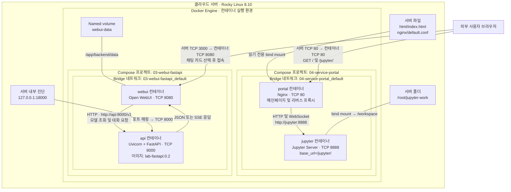
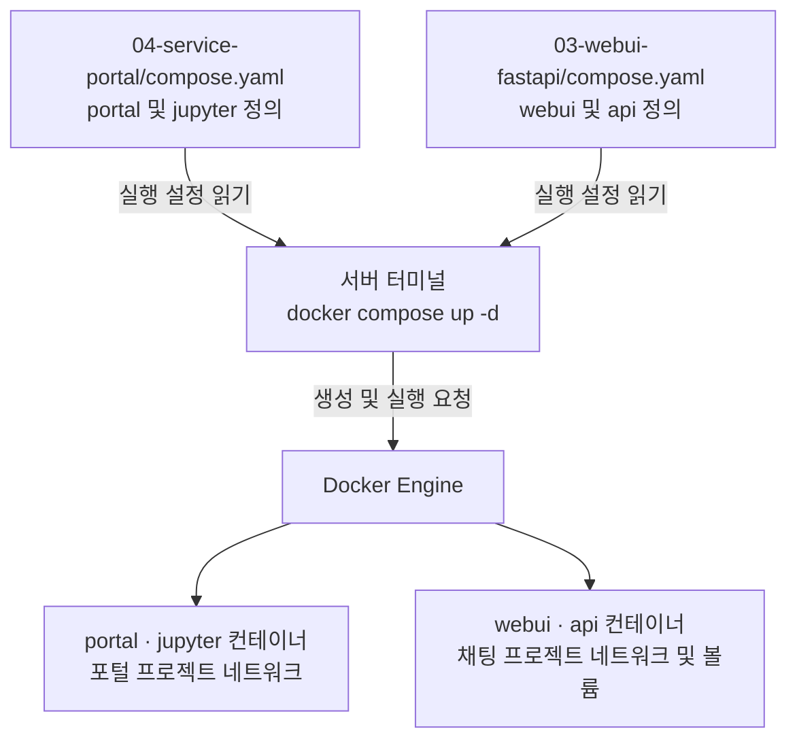

# 04. Docker 기반 서비스 포털 구축

## 1. 실습 목적

클라우드 서버 한 대에 여러 컨테이너를 실행하고,
메인페이지에서 Jupyter Lab과 AI 채팅 서비스로 이동하는 환경을 구성한다.

Docker Compose를 통해 서비스 실행 설정을 관리하고,
컨테이너 간 통신, 포트 매핑, 리버스 프록시와 데이터 저장 방식을 실습한다.

## 2. 구성 환경

| 항목 | 구성 |
|---|---|
| 호스트 OS | Rocky Linux 8.10 |
| 컨테이너 실행 환경 | Docker Engine |
| 서비스 구성 관리 | Docker Compose |
| 메인페이지 및 리버스 프록시 | Nginx |
| 코드 실습 환경 | Jupyter Lab |
| 채팅 인터페이스 | Open WebUI |
| 대화 API | FastAPI + Uvicorn |
| AI 모델 및 GPU | 사용하지 않음 |

FastAPI는 실제 LLM을 호출하지 않는다.
사용자의 질문에 정해진 문구를 붙여 반환하는 연습용 API다.

## 3. 서비스 아키텍처

실선 화살표는 요청·응답 경로를 나타낸다.
화살표 없는 선은 파일 또는 저장공간 연결을 나타낸다.



프로젝트명과 네트워크명은 현재 폴더명을 사용하는 기본 구성을 기준으로 한다.
`-p` 옵션이나 별도 이름 설정을 사용하면 달라질 수 있다.

## 4. Docker Compose는 어디에 사용되는가?

Docker Compose는 사용자 요청을 전달하는 웹 서버가 아니다.
YAML 파일에 작성한 설정으로 컨테이너와 네트워크 등을 구성하는 도구다.



| 구성요소 | 역할 |
|---|---|
| compose.yaml | 이미지, 실행 명령, 포트, 저장공간 등 정의 |
| Docker Compose | 설정을 읽어 Docker Engine에 작업 요청 |
| Docker Engine | 컨테이너, 네트워크, 볼륨 생성 및 관리 |
| 컨테이너 | 각 프로그램이 실제 실행되는 공간 |

## 5. 사용자 요청 흐름

### 메인페이지

1. 사용자가 서버의 HTTP 80번으로 접속한다.
2. Docker 포트 매핑을 통해 Nginx 컨테이너의 80번으로 전달된다.
3. Nginx가 `index.html`을 반환한다.
4. 브라우저에 Jupyter와 AI 채팅 카드가 표시된다.

### Jupyter Lab

1. 사용자가 Jupyter 카드를 선택한다.
2. 브라우저가 같은 서버의 `/jupyter/`로 요청한다.
3. Nginx가 `http://jupyter:8888`로 요청을 전달한다.
4. 사용자는 Jupyter 인증 후 노트북을 사용한다.
5. 코드 실행에 사용하는 WebSocket 연결도 Nginx가 전달한다.

Jupyter는 호스트에 별도의 포트를 공개하지 않는다.
Nginx와 같은 Docker 네트워크에서 통신한다.

### AI 채팅

1. 사용자가 AI 채팅 카드를 선택한다.
2. 브라우저가 같은 서버의 3000번 주소로 이동한다.
3. Open WebUI가 채팅 화면을 제공한다.
4. Open WebUI가 `http://api:8000/v1`로 API를 호출한다.
5. FastAPI가 연습용 답변을 반환한다.
6. Open WebUI가 답변을 표시한다.

현재 AI 채팅 요청은 Nginx를 거치지 않는다.
메인페이지에서 WebUI 주소로 이동하는 링크 방식이다.

## 6. 컨테이너 간 통신

| 출발지 | 목적지 | 연결 주소 |
|---|---|---|
| Nginx | Jupyter | http://jupyter:8888 |
| Open WebUI | FastAPI | http://api:8000/v1 |
| 서버 터미널 | FastAPI | http://127.0.0.1:18000 |

같은 Compose 네트워크에서는 서비스 이름을 DNS 이름으로 사용할 수 있다.

`jupyter`와 `api`는 서버의 공인 도메인이 아니라
각 Docker 네트워크 안에서 사용하는 서비스 이름이다.

컨테이너 내부의 `localhost`는 해당 컨테이너 자신을 의미한다.
따라서 WebUI에서 FastAPI를 호출할 때 `localhost:8000`을 사용하지 않는다.

두 Compose 프로젝트는 별도의 기본 네트워크를 사용하며,
현재 두 네트워크 사이의 직접 통신은 구성하지 않았다.

## 7. 포트 매핑

포트 매핑은 `서버 포트:컨테이너 내부 포트` 순서다.

| 서비스 | 설정 | 의미 |
|---|---|---|
| Nginx | 80:80 | 서버 80번 → Nginx 80번 |
| Jupyter | ports 설정 없음 | Docker 내부 네트워크로 접근 |
| Open WebUI | 3000:8080 | 서버 3000번 → WebUI 8080번 |
| FastAPI | 127.0.0.1:18000:8000 | 서버 내부 18000번 → API 8000번 |

WebUI에서 FastAPI로 보내는 요청은 내부 8000번으로 직접 연결된다.
서버의 18000번 포트는 진단용이며 이 통신 경로에 포함되지 않는다.

## 8. 데이터 및 설정 파일 저장

| 대상 | 저장 방식 | 컨테이너 내부 경로 |
|---|---|---|
| 메인페이지 | 서버 html 폴더를 읽기 전용 연결 | /usr/share/nginx/html |
| Nginx 설정 | 서버 설정 파일을 읽기 전용 연결 | /etc/nginx/conf.d/default.conf |
| Jupyter 작업 파일 | /root/jupyter-work를 연결 | /workspace |
| WebUI 계정 및 대화 | Docker named volume 사용 | /app/backend/data |

WebUI 볼륨의 Compose 선언 이름은 `webui-data`다.
실제 Docker 볼륨명에는 기본적으로 프로젝트 이름이 붙는다.

컨테이너를 재생성해도 연결한 폴더와 볼륨의 데이터는 유지된다.
단, 볼륨 자체를 삭제하면 저장 데이터도 없어질 수 있다.

## 9. 파일 구성

| 경로 | 역할 |
|---|---|
| 04-service-portal/compose.yaml | Nginx 및 Jupyter 실행 설정 |
| 04-service-portal/html/index.html | 서비스 선택 화면 |
| 04-service-portal/nginx/default.conf | 정적 파일 제공 및 프록시 설정 |
| 03-webui-fastapi/compose.yaml | WebUI 및 FastAPI 실행 설정 |
| 03-webui-fastapi/backend/Dockerfile | FastAPI 이미지 빌드 설정 |
| 03-webui-fastapi/backend/main.py | API 처리 코드 |
| 03-webui-fastapi/backend/requirements.txt | Python 패키지 목록 |

## 10. 실행 방법

### 사전 조건

- Docker와 Docker Compose가 설치되어 있어야 한다.
- 이전 실습에서 만든 로컬 이미지 `gpu-jupyter:v1`이 필요하다.
- `/root/jupyter-work` 작업 폴더를 사용한다.
- 외부에서 서버의 80번과 3000번으로 접근할 수 있어야 한다.

Jupyter 이미지는 이 폴더의 Compose 파일만으로 빌드되지 않는다.
다른 서버에서 실행하려면 해당 이미지를 먼저 준비해야 한다.

### 채팅 서비스 실행

```bash
cd ~/docker-operations-lab/03-webui-fastapi
docker compose up -d --build
docker compose ps
```

### 포털 및 Jupyter 실행

```bash
cd ~/docker-operations-lab/04-service-portal
docker compose config -q
docker compose up -d
docker compose exec portal nginx -t
docker compose ps
```

### 브라우저 접속

- 메인페이지: `http://서버주소/`
- Jupyter: `http://서버주소/jupyter/`
- AI 채팅: `http://서버주소:3000/`

클라우드가 포트별로 별도의 접속 도메인을 제공한다면
메인페이지의 AI 채팅 링크를 해당 URL에 맞게 수정해야 한다.

## 11. 확인 및 로그 조회

```bash
cd ~/docker-operations-lab/04-service-portal

# 메인페이지 응답
curl -I http://127.0.0.1/

# Jupyter에 GET 요청을 보내 응답 헤더 확인
curl -sS -D - -o /dev/null http://127.0.0.1/jupyter/

# Nginx 및 Jupyter 로그
docker compose logs --tail 30 portal jupyter
```

```bash
cd ~/docker-operations-lab/03-webui-fastapi

# 모델 목록 확인
curl http://127.0.0.1:18000/v1/models

# FastAPI 요청 로그 확인
docker compose logs -f api
```

`logs -f` 종료 시 Ctrl+C를 눌러도 컨테이너는 계속 실행된다.

### 관찰한 응답

- 메인페이지: HTTP 200 OK
- `/jupyter`: `/jupyter/`로 HTTP 302 이동
- `/jupyter/`: HEAD 요청에 HTTP 405 관찰

`curl -I`는 HEAD 요청이다.
405만으로 장애를 단정하지 않고 GET 요청 및 브라우저로 추가 확인한다.

## 12. 실습 범위와 주의사항

- 실제 GPU 연산이나 LLM 추론은 수행하지 않는다.
- FastAPI는 연습용 응답을 반환한다.
- 현재 포털은 HTTP 기반 개인 실습 구성이다.
- Jupyter 토큰 인증과 WebUI 계정 인증을 유지한다.
- 토큰, 비밀번호, 사용자 대화 및 작업 데이터는 GitHub에 올리지 않는다.
- 운영 환경으로 확장할 경우 HTTPS와 접근 제어를 구성해야 한다.
